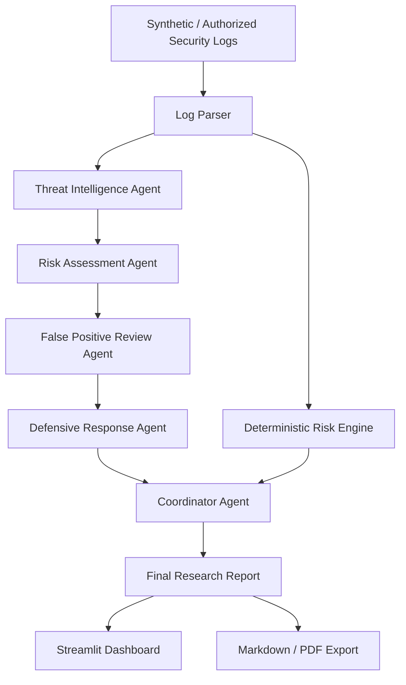

# 🛡️ CyberShield WarAI
### Local Multi-Agent AI Cyber Threat Intelligence Research Lab

CyberShield WarAI is a locally hosted, multi-agent defensive cyber threat intelligence research lab. It analyzes synthetic or explicitly authorized, sanitized security logs and generates structured findings, risk assessments, and defensive recommendations.

## 🏢 Research Organisation

**Masmatix Innovations**

CyberShield WarAI is an AI-assisted defensive cybersecurity
research project developed under the Masmatix Innovations
technology and research portfolio.

- Company website: https://masmatixinnovations.co.uk/index.html
- Research & Insights: https://masmatixinnovations.co.uk/insights/

Visit our company website to learn more about our work and
explore our published research articles.

## 🧩 System Architecture



## ✨ Key Features

- Multi-agent AI security analysis using local Ollama models.
- Threat intelligence and risk assessment.
- False-positive review.
- Defensive response recommendations.
- Deterministic heuristic risk scoring.
- Interactive Streamlit dashboard.
- Markdown and PDF report exports.
- Automated parser and risk-engine tests.

## 🧠 Multi-Agent Architecture

| Agent | Responsibility |
|---|---|
| Threat Intelligence Agent | Reviews security events and identifies notable patterns |
| Risk Assessment Agent | Evaluates defensive review priorities |
| False Positive Review Agent | Considers benign explanations and evidence gaps |
| Defensive Response Agent | Suggests safe defensive actions |
| Coordinator Agent | Combines findings into a final report |

## 🛠️ Technology Stack

- Python 3.11
- Streamlit
- Ollama
- Locally hosted language models
- Pandas
- ReportLab
- Pytest

## ⚙️ Requirements

- macOS, Linux, or Windows
- Python 3.11
- Ollama installed and running
- Required Ollama models downloaded

The workflow uses these models by default:

- `mistral:7b`
- `qwen2.5:7b`
- `qwen2.5:3b`
- `llama3.2:3b`
- `llama3.1:8b`

Download the models with Ollama before running the application.

## 🚀 Installation

Clone the repository:

```bash
git clone https://github.com/MHKhan50/cybershield-warai.git
cd cybershield-warai
```

Create and activate a virtual environment:

```bash
python3.11 -m venv .venv
source .venv/bin/activate
```

Install dependencies:

```bash
python -m pip install -r requirements.txt
```

Start Ollama and download the required models:

```bash
ollama pull mistral:7b
ollama pull qwen2.5:7b
ollama pull qwen2.5:3b
ollama pull llama3.2:3b
ollama pull llama3.1:8b
```

Run the application:

```bash
streamlit run app.py
```

Open the local Streamlit address displayed in your terminal, usually:

`http://localhost:8501`

## 🧪 Run Tests

```bash
python -m pytest -v
```

## 📊 Risk Scoring

The risk engine assigns deterministic heuristic scores to help prioritize defensive review.

These scores are review-priority indicators, not probabilities of compromise. They are not calibrated predictions and should be interpreted alongside relevant evidence and analyst judgment.

## 🔐 Responsible Use & Safety

CyberShield WarAI is designed for defensive research and security analysis.

- Use synthetic or explicitly authorized, sanitized logs only.
- Do not submit passwords, access tokens, personal data, or other secrets.
- Treat log contents and AI-generated findings as untrusted input.
- Validate all findings and recommendations with a qualified human analyst.
- No live network scanning, exploitation, malware execution, credential theft, stealth, or persistence functionality is intended.

## 📁 Project Structure

```text
cybershield-warai/
├── app.py
├── cybershield/
│   ├── workflow.py
│   ├── ollama.py
│   ├── log_parser.py
│   ├── risk.py
│   └── report.py
├── data/
│   └── synthetic_defensive_logs.csv
├── research/
│   └── paper_outline.md
├── tests/
│   ├── test_parser.py
│   └── test_risk.py
├── requirements.txt
├── .env.example
└── README.md
```

## 👨‍💻 Organisation & Project

**Masmatix Innovations**

Website: https://masmatixinnovations.co.uk/

Research & Insights:
https://masmatixinnovations.co.uk/insights/

GitHub:
https://github.com/MHKhan50/cybershield-warai

---

**CyberShield WarAI — AI-assisted defensive cyber threat intelligence research.**
